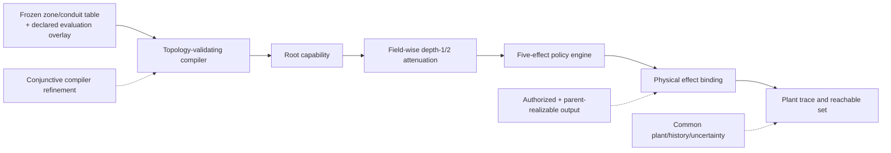
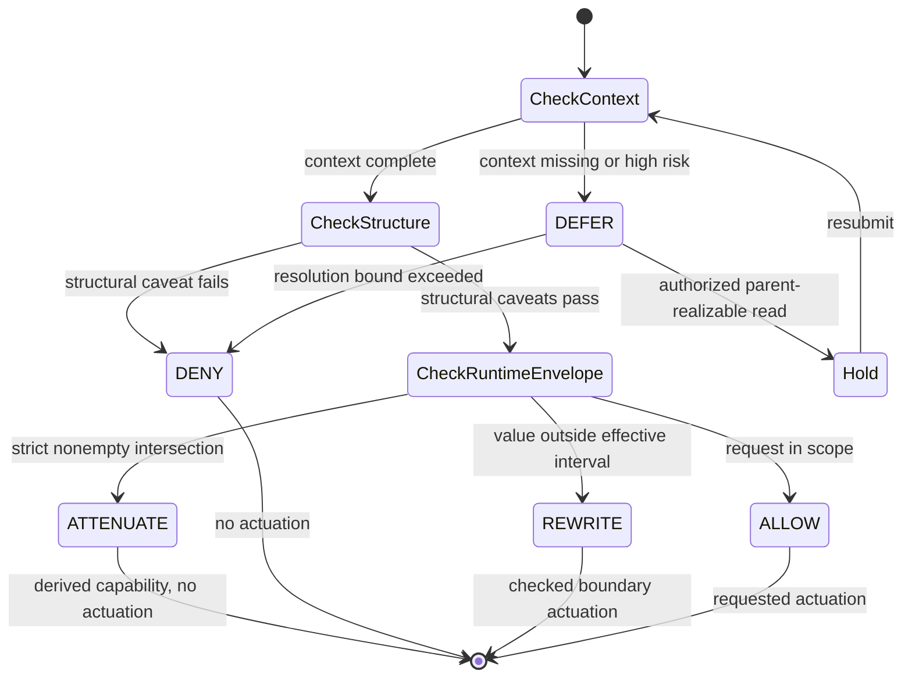
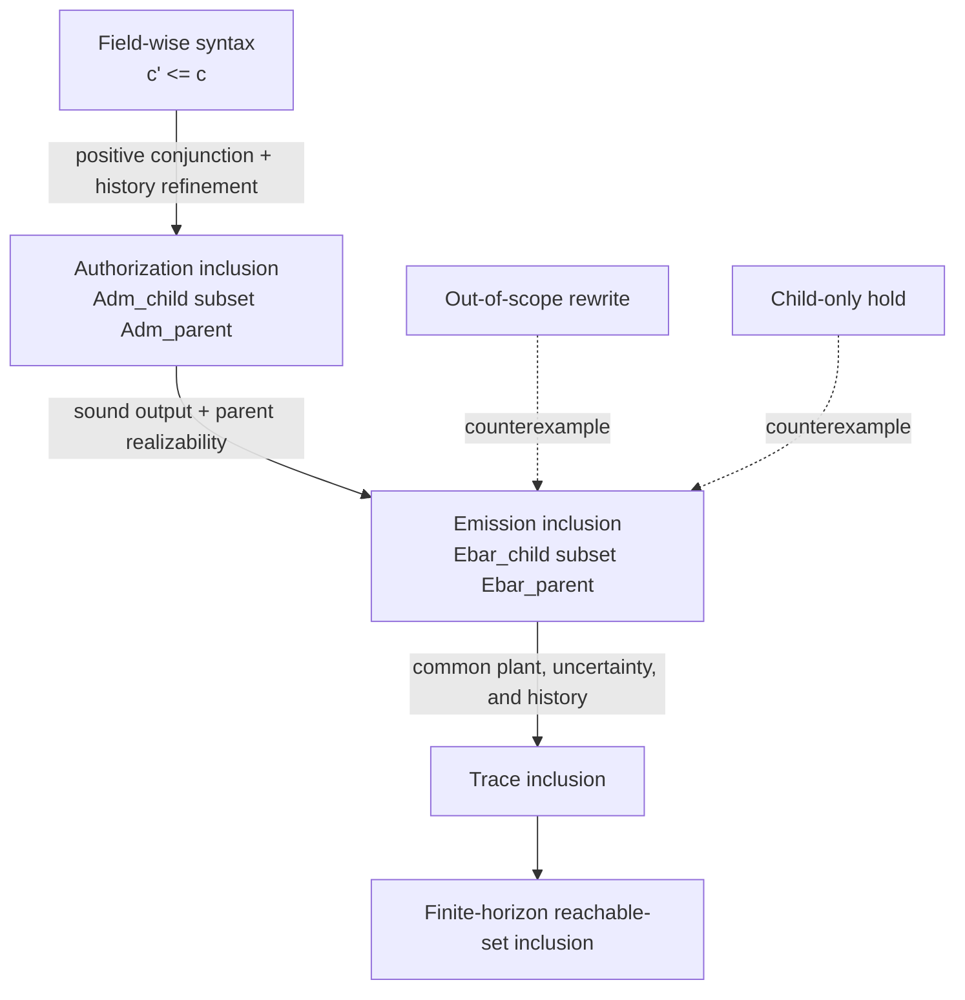
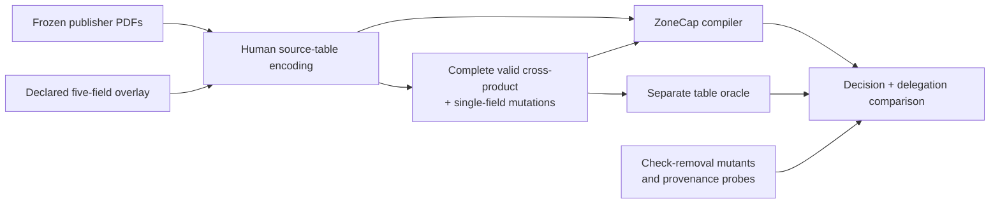
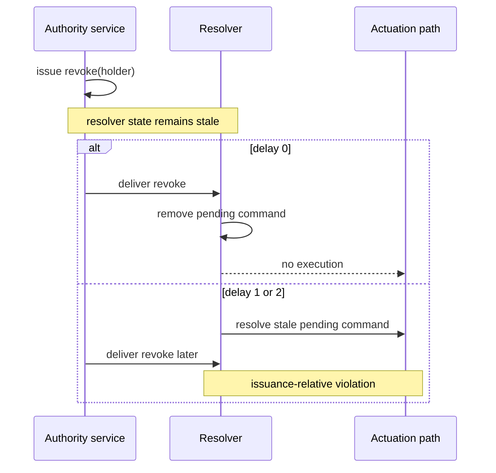

# ZoneCap: Attenuable capabilities linking industrial zone/conduit policy to physical reachability

## Abstract

Industrial control commands increasingly cross organizational and network boundaries through software principals and autonomous agents. Existing capability systems can narrow digital permissions, while cyber-physical runtime enforcers can suppress or correct unsafe commands. Neither property alone establishes that a delegated principal induces no physical behavior beyond that of its parent. We present ZoneCap, a compiler and runtime authorization semantics that connect source-derived zone/conduit policy tables to attenuable capabilities over assets, actions, physical parameters, time, operating mode, and required event history. The key result is a conditional refinement theorem: positive conjunctive attenuation implies inclusion of request-abstracted physical traces and finite-horizon reachable sets when runtime outputs remain authorized and parent-realizable. The proof closed all registered obligations and was paired with exact audits over 393,750 one-dimensional models and 2,756,250 horizon checks with no inclusion violation, while premise-removal tests recovered the expected counterexamples. <!-- Evidence: E01, E04 --> On a complete 58,968-case corpus generated from a frozen CPwE/CIP Security matrix and an ENISA landside-signalling zone/conduit subgraph plus an explicit source-independent overlay, ZoneCap matched a separate table oracle on every decision and passed 672 delegation-dimension checks. <!-- Evidence: E07 --> A registered actuation-event semantics for `ALLOW`, `DENY`, `ATTENUATE`, `REWRITE`, and `DEFER` preserved the refinement over 58,968 one-request traces, 4,536 composed traces, and 492,156 bounded exhaustive words with no registered safety or refinement violation. <!-- Evidence: E12, E14 --> Adversarial scheduling nevertheless produced eight issuance-relative stale executions under delayed revocation delivery, showing that revocation requires an explicit freshness or atomic-delivery contract. <!-- Evidence: E19 --> Target OpenPLC/Jetson latency remains unmeasured, and we make no deployment-performance claim.

**Keywords:** capability-based access control; cyber-physical systems; industrial control systems; IEC 62443; runtime enforcement; reachability; delegation

## 1. Introduction

Industrial automation and control systems divide assets and communication paths into zones and conduits so that risk and security requirements can be assigned at system boundaries [1]. Commands crossing those boundaries are no longer issued only by a local operator or a fixed programmable logic controller. Maintenance services, orchestration software, and model-driven agents may all request actuation on behalf of other principals. This creates an authorization question that network segmentation alone does not answer: when authority is delegated and narrowed, what physical behavior remains possible?

Capability systems provide a natural representation of delegated authority. Distributed CPS capabilities and CHERI Macaroons showed that physical resources can be scoped, delegated, and enforced close to resource-owning devices [2,3]. Recent agent-oriented systems further combine signed capabilities, physical constraints, approval tiers, or delegation contracts [10--12]. These mechanisms reduce digital privilege, but digital subset checks do not automatically imply a subset relation between the physical trajectories produced after enforcement. A child request may, for example, be rewritten to a different authorized value rather than simply denied.

Physics-aware access control and runtime enforcement address the complementary half of the problem. CPAC derives access-control decisions from a physical grid model [4], while Smart I/O and edit-automata systems suppress, correct, or autonomously emit events to keep industrial processes within a specification [5,8,9]. IEC 62443 tooling has also progressed from manual risk analysis toward automated assessment and formal zone/conduit modeling [13,14]. These lines establish important policy, enforcement, and standards mechanisms. Their guarantees, however, do not connect a syntactic delegation relation over zone/conduit authorization fields to inclusion of the physical traces and reachable sets induced by the resulting runtime decisions.

The missing link is an emission refinement relation. A child capability must authorize a subset of the parent's physical inputs at the same authorization-relevant history, and every child output chosen by a runtime effect must remain realizable under the parent. Under these conditions, physical trace inclusion follows by induction for any common plant transition relation, initial set, disturbance set, and finite horizon. This separates the reusable proof obligation from any particular linear dynamics or controller trajectory.

ZoneCap operationalizes this insight in three accepted contributions. First, it defines a field-wise conjunctive attenuation order and proves that, under six explicit obligations, this syntax induces physical trace and reachable-set inclusion (C1). Second, it compiles two frozen source-derived zone/conduit tables, augmented with a declared evaluation overlay, and matches a separate table oracle over the complete generated corpus while rejecting registered depth-1 and depth-2 privilege widening (C6). Third, it gives a registered actuation-event semantics in which `ALLOW`, `DENY`, `ATTENUATE`, `REWRITE`, and `DEFER` preserve the refinement when rewrites and holds are authorized and parent-realizable (C7). The evaluation combines exact enumeration, all five preregistered randomized seeds, source/provenance checks, mutation analysis, fair common-subset baselines, and bounded exhaustive sequences. It also reports two limits rather than hiding them: the unfenced protocol fails issuance-relative revocation under delayed delivery, and the approved OpenPLC/Jetson performance experiment has not yet returned.

## 2. Related work

### 2.1 Capabilities for cyber-physical and agent systems

Dodson's CPS capability architecture and CHERI Macaroons compose hardware-enforced architectural capabilities with cryptographic network tokens, enabling scoped authority to be constructed, delegated, and exercised in robotics and industrial-control demonstrators [2,3]. SINT extends this engineering direction to agent-facing gateways with signed tokens, physical maxima, attenuation-only delegation, revocation, approvals, and audit logging [11]. ZTPM represents physical impact and live context as typed runtime policy dimensions for LFM-controlled robots [10]. DARC treats authority-bearing multi-agent handoffs as machine-checkable contracts with attenuation, obligations, expiry, lineage, and revocation closure [12]. These systems establish that capabilities and delegation are relevant to physical or agentic systems. ZoneCap addresses a narrower formal question: when does field-wise attenuation imply inclusion of the physical behavior induced after runtime rewriting or deferral?

### 2.2 Physics-aware authorization and runtime enforcement

CPAC uses information-flow analysis over physical grid models to generate and enforce policies [4]. TwinGridShield similarly evaluates grid-agent actions against a deterministic network twin and shows that authorization outcomes remain sensitive to model mismatch [17]. Runtime-enforcement research instead mediates a controller's event stream. Schneider characterized the limits of security automata [6], and edit automata generalized runtime intervention to suppression and insertion [7]. Smart I/O moves enforcement close to industrial I/O [5]; Lanotte, Merro, and Munteanu synthesize monitors that correct or suppress compromised-controller actions and establish soundness and progress properties [8]; Baird and colleagues compose policies in parallel hardware to improve scaling [9]. ZoneCap does not claim a faster enforcer or replace those synthesis mechanisms. It contributes an authorization refinement interface that a runtime effect must satisfy if delegated physical authority is to remain monotone.

### 2.3 IEC 62443 modeling and automation

IEC 62443-3-2 specifies security risk assessment for system design and uses zone/conduit decomposition as a central system abstraction [1]. Recent work automates parts of that risk-assessment workflow from PLCOpen and threat models [13], while a security-oriented domain-specific language formalizes zone/conduit installations and validation rules [14]. These contributions concern risk modeling and secure-by-design description rather than a runtime capability object. ZoneCap uses selected published zone/conduit structures as frozen compiler inputs; it does not claim to automate the complete standard or establish IEC certification.

## 3. Problem formulation

### 3.1 Capability syntax and attenuation

Let the discrete-time plant be

\[
\mathcal{P}=(X,U,W,F), \qquad x_{t+1}=F(x_t,u_t,w_t),
\]

with initial-state set \(X_0\), disturbance set \(W\), and physical inputs \(U\). An authorization-relevant physical history \(\eta_t\) contains observed plant states, emitted physical events, trusted operating mode, and time. It excludes token-internal decisions and raw requests that emitted no physical action.

A ZoneCap capability \(c\) binds issuer and subject to source and target zones and contains positive conjunctive caveats over conduit set \(K\), asset set \(A\), operation set \(O\), parameter interval \(I_u\), time interval \(I_t\), mode set \(M\), and an admissible physical-history language \(L\). Compilation yields an authorization relation \(\operatorname{Adm}_c(\eta)\subseteq U\).

A child \(c'\preceq c\) preserves the issuer and zone endpoints while narrowing every remaining dimension:

\[
K'\subseteq K,\; A'\subseteq A,\; O'\subseteq O,\; I'_u\subseteq I_u,\;
I'_t\subseteq I_t,\; M'\subseteq M,\; L'\subseteq L.
\]

The implementation realizes history-language refinement by requiring the parent's event sequence to be a prefix of the child's longer required sequence. Subject identity may change during delegation because the theorem compares physical authority, not identity equality. This definition contains no plant dynamics and no reachable-set predicate.

### 3.2 Request-abstracted physical semantics

For a raw request \(q\), let \(\operatorname{Emit}_c(\eta,q)\subseteq U\) denote the physical input emitted by the runtime effect. The relation used for reachability is

\[
\overline{E}_c(\eta)=\bigcup_{q\in Q}\operatorname{Emit}_c(\eta,q).
\]

This request abstraction is necessary. If a parent interval is \([0,1]\), a child interval is \([0,0.4]\), and the raw request is \(0.8\), the parent may allow \(0.8\) while the child rewrites it to \(0.4\). Same-request output inclusion is therefore false, even though \(0.4\) remains physically realizable under the parent. Exp-01 retained exactly such a counterexample rather than redefining the claim. <!-- Evidence: E01 -->

We define \(\operatorname{Tr}_H(c)\) as the physical traces of length at most \(H\) from \(X_0\), using disturbances in \(W\) and inputs in \(\overline{E}_c(\eta_t)\). The reachable set \(\operatorname{Reach}_t(c)\) is the projection of these traces onto \(x_t\). It is a union over authorized physical-action and disturbance sequences, not a probability distribution or the trajectory of a fixed controller.

## 4. ZoneCap method

### 4.1 Overview

ZoneCap has five interfaces: source-table encoding, capability compilation, attenuation validation, runtime decision, and physical effect binding. The first two turn a directed zone/conduit grant into a root capability. Delegation then applies field-wise subset checks. At request time, the policy engine returns one of five effects, and the effect binding either emits an authorized physical action, emits the registered hold, or emits nothing. The refinement proof connects these interfaces to plant traces rather than treating the compiler or enforcer as a black box.

**Figure 1 | ZoneCap compiler, delegation, enforcement, and physical-refinement pipeline (F1).**

<!-- Display: F1; Evidence: E01, E07, E12 -->

### 4.2 Source-table compiler

The compiler accepts named zones, directed conduits, and policy rows. It rejects duplicate or unknown zones/conduits, mismatched conduit endpoints, assets or actions outside the conduit scope, and parameter intervals outside the conduit envelope. A successful row becomes a root capability whose zone endpoints and conduit identity are invariant across delegation and whose other authority fields may only narrow.

The two evaluation inputs do not supply all capability fields. The CPwE/CIP Security matrix and the ENISA landside-signalling subgraph ground the directed zone/conduit structure [15,16]. During table encoding, each target zone receives a deterministic target-asset identifier. A common source-independent behavior/context overlay supplies `read`/`write` actions, the normalized parameter interval, tick window, modes, and an `authenticate` pre-action sequence. The asset identifiers and overlay test representation and attenuation; they are not attributed to IEC 62443, Rockwell Automation/Cisco, or ENISA.

### 4.3 Attenuation validator

Given a proposed child, the validator checks issuer equality and invariant zone binding, subset relations for conduit, asset, action, parameter, time, and mode, and prefix extension for the required sequence. It rejects rather than normalizes an invalid ZoneCap child. The lifecycle operation may replace the subject and increments delegation depth, but no child gains physical authority not held by its parent. These eight checked authority dimensions define C6; the source-independent status of five of them remains part of the claim. <!-- Evidence: C6; E07-E09 -->

### 4.4 Runtime decision and effect binding

The policy engine is fail-closed and evaluates a request in a fixed order. Missing context or a high-risk request yields `DEFER`. A failed subject, zone, conduit, asset, action, time, mode, or history check yields `DENY`. A runtime parameter envelope that strictly intersects the presented interval yields `ATTENUATE` and a derived child capability without executing the request. A structurally valid value outside the interval yields `REWRITE` to the nearest authorized boundary. A request satisfying all checks yields `ALLOW`.

The effect binding gives those decisions an actuation-event meaning. `ALLOW` emits the authorized request; `REWRITE` emits only the checked boundary value; `DEFER` emits the registered `read` hold within the effective capability; `DENY` and `ATTENUATE` emit no physical action. A bounded executor tracks consecutive deferrals and returns a no-output denial after the registered resolution bound. An invalid rewrite or hold also fails closed. This is not a fixed-tick scan semantics: a deployment in which time advances without a command needs a separately verified common idle binding.

**Figure 2 | Registered five-effect actuation-event semantics (F4).**

<!-- Display: F4; Evidence: E12-E16 -->

## 5. Syntactic-to-physical refinement

### 5.1 Proof obligations

The result depends on six obligations. First, attenuation is defined syntactically rather than by reachable-set inclusion. Second, positive caveats combine conjunctively, without fallback grants or unproved non-monotone conflict combiners. Third, child histories accepted by the required-sequence language are also accepted by the parent, and both evaluate the same physical-history projection. Fourth, runtime emission is sound and parent-realizable, including rewrite and hold behavior. Fifth, parent and child share \(F\), \(X_0\), \(W\), and the horizon. Sixth, reachability is the union over all admitted physical-action/disturbance sequences.

### 5.2 Compiler and emission refinement

**Lemma 1 (compiler refinement).** Because every positive child field is a subset of its corresponding parent field, and child sequence extension refines the parent's history language,

\[
c'\preceq c \Longrightarrow
\operatorname{Adm}_{c'}(\eta)\subseteq\operatorname{Adm}_{c}(\eta)
\quad\text{for every related physical history }\eta.
\]

**Lemma 2 (emission refinement).** Sound emission places every ordinary child output in \(\operatorname{Adm}_{c'}(\eta)\), and Lemma 1 places it in the parent's authorization relation. Parent realizability supplies a raw parent request that emits the same action. A child hold is directly covered by the common parent-admissible hold clause. Hence

\[
\overline{E}_{c'}(\eta)\subseteq\overline{E}_{c}(\eta).
\]

The second lemma is the bridge missing from a purely digital subset check. It is also why an arbitrary “safe” rewrite function is insufficient: authorization membership alone does not ensure that the parent enforcer can realize the child's chosen output.

### 5.3 Trace and reachable-set theorem

**Theorem 1 (attenuation monotonicity).** Under the six obligations, for every finite \(H\),

\[
c'\preceq c \Longrightarrow
\operatorname{Tr}_H(c')\subseteq\operatorname{Tr}_H(c)
\Longrightarrow
\forall t\le H:\operatorname{Reach}_t(c')\subseteq\operatorname{Reach}_t(c).
\]

The proof is induction on physical transitions. The empty trace shares \(X_0\). If a child trace is also a parent trace through \(\eta_t\), Lemma 2 places its next input in the parent emission relation. Choosing the same disturbance and applying the common transition relation produces the same successor. Projection gives reachable-set inclusion. For the one-dimensional linear system \(x_{t+1}=a x_t+b u_t+w_t\), interval images and Minkowski addition preserve set inclusion even for signed \(a\) and \(b\). In MIMO and nonlinear systems, the transition-system proof applies directly whenever emission refinement holds; a convex over-approximation alone is not a proof.

**Figure 3 | Refinement chain and falsifiable interfaces (F2).**

<!-- Display: F2; Evidence: E01-E04, E06 -->

## 6. Evaluation protocol

### 6.1 Fixed protocol and evidence classes

The evaluation protocol was fixed before confirmatory runs. Development fixtures were excluded from claim evidence. Exact proof/enumeration runs were seedless; the MIMO/history falsification study reported all five preregistered seeds: 104729, 130363, 155921, 196613, and 262147. <!-- Evidence: E03 --> Every run directory retained its configuration, command, seed, log, metrics, and input/output hashes. Perfect agreement or implausibly fast timing triggered predefined leakage, disabled-check, and clock audits.

C1 was evaluated as a proof plus falsification ladder: exact one-dimensional enumeration, syntax/combiner mutation, seeded coupled and history-dependent systems, premise removal/restoration, a fair capability common subset, and boundary sanity cases. Random search was never treated as the proof of the universal theorem.

C6 used two source artifacts frozen before policy encoding and held-out execution: the CPwE/CIP Security guide and ENISA's railway zoning/conduit report [15,16]. The corpus contained every valid overlay cross-product and one mutation for each registered invalid field; no case was removed after evaluation. The oracle read the frozen table directly and did not import the compiler, engine, or capability model. Both paths nevertheless shared the same human-authored table, a limitation addressed in Section 9.

**Figure 4 | Frozen-source generation and separate decision paths (F3).**

<!-- Display: F3; Evidence: E07-E11 -->

C7 reused the frozen C6 records. Each valid request generated a five-step `ATTENUATE -> DEFER -> ALLOW -> REWRITE -> DENY` trace with at most two later policy transitions to resolve an attenuated or deferred request. A separate exhaustive study enumerated every word through length five over a state-dependent five-symbol request/context alphabet. These are bounded semantics checks, not unbounded liveness proofs.

### 6.2 Baselines and fairness

For C1, ZoneCap, pinned SINT, and a Dodson/CHERI-Macaroons schema adapter were compared only on invariant resource, action subset, and a non-negative physical upper bound. SINT's concrete delegator was executed at commit `2461a911b8c3d7ed9da3f7662b33678f688eb826`; the Dodson baseline remained a schema adapter and was not presented as a full artifact reproduction.

For C6, OPC UA role, PLC ABAC, and pinned-SINT projections received the same 58,968-case corpus. <!-- Evidence: E10 --> Agreement was assessed only where a projection fully represented the mutated field; unrestricted full-corpus dimensions were reported rather than misclassified as implementation errors. For C7, deny-only received the same local request, capability, context, and history at each step. Lanotte/Roop and SINT effect coverage was mapped from primary sources and pinned code; unavailable licensed/hardware runtime measurements remained not applicable.

## 7. Results

### 7.1 Syntactic attenuation refined physical reachability under the registered obligations

The formal audit closed every registered proof obligation and the exact one-dimensional implementation found no child state outside its parent across 393,750 models and 2,756,250 horizon checks. <!-- Evidence: E01 --> This zero result was not accepted in isolation. Fourteen unsafe validator/default/combiner/semantic mutants all produced retained counterexamples, whereas two policy-changing but monotone combiners survived C1 and were routed to the decision-equivalence claim. <!-- Evidence: E02 -->

**Table 1 | Evidence for conditional physical refinement (T1).** Zero denotes no registered violation, not absence of the stated assumptions.

| Test | Scope | Main observation | Control or boundary | Evidence |
|---|---|---|---|---|
| Exact theorem audit | 393,750 1D models; 2,756,250 horizon checks | 8/8 obligations closed; 0 inclusion violations | 1 stronger same-request counterexample retained | E01 |
| Syntax mutation | 14 unsafe mutants | 14/14 killed | 2 monotone policy-semantic changes routed to C6 | E02 |
| MIMO/history | 5 preregistered seeds; 720 + 400 horizon checks | 0 violations for every seed | 2/2 widening controls detected | E03 |
| Effect premises | 6 configurations | 0 restored violations; all 5 effects reached | 2/2 removed obligations produced counterexamples | E04 |
| Common subset | 72 request pairs; 63 plant/horizon checks | 0 cross-adapter or inclusion mismatch | Only 3 common authority dimensions | E05 |
| Sanity | 9 fixed cases | 9/9 expected outcomes | Widening rejected and physically detected | E06 |

<!-- Display: T1; Evidence: E01-E06 -->

The MIMO/history study then tested the scalar-artifact alternative. Each of the five seeds had zero MIMO, trace, and history-dependent reachable-state violations, for 720 MIMO horizon checks, 400 history horizon checks, and 8,854 child-trace membership checks in aggregate. <!-- Evidence: E03 --> Removing rewrite closure or the parent-admissible hold premise produced both expected horizon-one counterexamples; restoring the premises reduced the registered violations to zero while reaching all five effects. <!-- Evidence: E04 --> The result therefore supports the conditional theorem, not an unconditional statement that any restrictive-looking runtime behavior preserves physical reachability.

### 7.2 The compiler matched the frozen table oracle and rejected registered widening

The complete C6 corpus contained 58,968 cases: 42,120 from the CPwE matrix and 16,848 from the ENISA subgraph. Of these, 4,536 were valid overlay cases and 54,432 were single-field mutations. The compiler and separate oracle agreed on all cases. Across 84 registered delegation edges, all 672 dimension checks passed. <!-- Evidence: E07 -->

**Table 2 | Frozen-corpus decision and delegation results (T2).**

| Component | Cases/checks | Mismatch or failure | Stress control | Evidence |
|---|---:|---:|---|---|
| CPwE/CIP Security matrix | 42,120 decisions | 0 | Valid cross-product + all mutation categories | E07 |
| ENISA landside-signalling subgraph | 16,848 decisions | 0 | Valid cross-product + all mutation categories | E07 |
| Depth-1/2 delegation | 84 edges; 672 dimension checks | 0 | Eight authority dimensions | E07 |
| Generated-corpus ablation | 58,968 decisions | 0 | 10/10 check-removal mutants killed | E08 |
| Multi-conduit and widening | 24 path cases; 32 widening attempts | 0 path mismatch; 0 accepted widening | Every widening localized to one of eight dimensions | E09 |
| Boundary sanity | 22 cases | 0 expectation mismatch | 9 expected fail-closed compile rejections | E11 |

<!-- Display: T2; Evidence: E07-E09, E11 -->

Perfect agreement created a leakage risk, so we compared the generated corpus with six handwritten happy paths. Both had zero ordinary mismatch, but the complete generated corpus killed all ten check-removal mutants whereas the handwritten set killed none. Four source-grant removal/addition probes also changed the expected roots, descendants, case counts, conduit assignments, and assets without failure. <!-- Evidence: E08 --> In the separate depth/path test, all 24 direct and multi-hop cases matched the oracle, all 32 localized widening attempts were rejected, and all 672 repeated legal-delegation checks passed. <!-- Evidence: E09 --> These controls reduce the likelihood of a disabled compiler check; they do not independently validate the common source-table interpretation.

**Table 3 | Fair capability and policy-projection baselines (T3).** Full-corpus unrestricted counts measure missing modeled dimensions, not product-level false-allow rates.

| Comparison | Fair scope | Agreement in fair scope | Full-corpus boundary | Evidence |
|---|---|---:|---|---|
| ZoneCap / pinned SINT / Dodson schema adapter | Resource, action subset, non-negative upper bound | 0 decision or reachable-set mismatch over 72 request pairs and 63 plant/horizon checks | Dodson path is a schema adapter; richer fields excluded | E05 |
| OPC UA role projection | Subject, asset, action | 0 mismatch | 40,824 mutations unrestricted | E10 |
| PLC ABAC projection | Subject, zones, asset, action, time, mode | 0 mismatch | 18,144 mutations unrestricted | E10 |
| Pinned-SINT profile | Subject, resource, action, upper physical maximum, expiry, depth | 0 mismatch | 28,728 mutations unrestricted | E10 |

<!-- Display: T3; Evidence: E05, E10 -->

The baseline comparison shows complementarity rather than a universal dominance result. Each projection agreed where it could express the relevant field. ZoneCap's distinction is the simultaneous conjunction used by C6 and its connection to the C1 proof obligations; the full-corpus counts cannot be extrapolated to a deployed OPC UA, ABAC, or SINT system.

### 7.3 The registered five-effect semantics preserved the refinement in bounded traces

The main effect run evaluated every frozen one-request case and added one five-step composed trace for each valid case. Across 58,968 one-request traces and 4,536 composed traces, all five effects were reached and no registered authority, parent-realizability, trace-inclusion, stutter, effect-order, or bounded-deadlock violation occurred. All five negative-control mutants were detected. <!-- Evidence: E12 -->

**Table 4 | Five-effect composition and sequence coverage (T4).**

| Test | Scope | Registered violation | Coverage/control | Evidence |
|---|---:|---:|---|---|
| One-request effect evaluation | 58,968 traces | 0 | Valid plus all frozen mutations | E12 |
| Five-step composition | 4,536 traces; 22,680 steps | 0 | All five effects; 5/5 mutants killed | E12 |
| Exhaustive word enumeration | 492,156 words; 492,030 transitions; horizon 5 | 0 | 25/25 bigrams; 125/125 trigrams; 3/3 mutants killed | E14 |
| Named-path baseline | 126 words; 630 transitions | 0 | 4 bigrams; 3 trigrams; 0/3 sequence mutants killed | E14 |
| Effect sanity | 5 fixed cases | 0 expectation mismatch | Premise-removal counterexample recovered | E16 |

<!-- Display: T4; Evidence: E12, E14, E16 -->

Exhaustive enumeration mattered even though the named paths reached every individual effect. The complete length-zero-through-five language covered every effect bigram and trigram and killed all three sequence-triggered mutants; one named five-effect path per scope killed none. <!-- Evidence: E14 --> This establishes the registered bounded transition space, not unbounded asynchronous progress.

### 7.4 Rich effects preserved safety while serving cases that deny-only blocked

Replacing `ATTENUATE`, `REWRITE`, and `DEFER` with local no-output denial retained zero safety violations but removed behavior that the registered semantics treated as recoverable or safely rewritten. Deny-only blocked 13,608 rewrite steps, equal to 16.67% of the 81,648 constructed policy steps and 60% of the constructed safe-service opportunities, and removed 9,072 attenuation/deferral recovery decisions. <!-- Evidence: E13 --> These rates characterize the fixed evaluation corpus, not an operational workload distribution.

**Table 5 | Deny-only ablation and source-grounded effect coverage (T5).**

| System/comparison | Exact request-time effects | Partial/absent effects | Quantitative observation | Evidence |
|---|---|---|---|---|
| ZoneCap | 5/5 | 0 | Registered full semantics | E15 |
| Deny-only ablation | `ALLOW`, `DENY` | Replaces 3 effects with deny | 13,608 false blocks; 9,072 lost recoverable decisions; 0 safety violations | E13 |
| Lanotte/Roop family | `ALLOW`, `DENY`, edit/`REWRITE` | `ATTENUATE`, approval `DEFER` absent | 3/5 exact mechanism matches | E15 |
| Pinned SINT | `ALLOW`, `DENY` | 2 partial lifecycle analogues; runtime `REWRITE` absent | 2/5 exact, 2/5 partial, 1/5 absent; 13,608 rewrites project to denial | E15 |

<!-- Display: T5; Evidence: E13, E15 -->

This mapping does not claim that ZoneCap subsumes the formal guarantees or implementation scale of prior enforcers. Lanotte/Roop has exact pass, suppress, and correction mechanisms but no capability-attenuation or approval-stutter analogue in the mapped lifecycle. SINT has delegation-time attenuation and approval escalation, but its pinned validator denies a physical constraint violation rather than rewriting the outgoing request. The comparison isolates the operational role of the five ZoneCap effects.

## 8. Negative result: revocation freshness

The original concurrency claim required no execution after revocation under the preregistered bounded model. Initial enumeration appeared to satisfy it: through bound five, 793,800 event words and 793,797 transitions produced 26,038 executions, 4,534 conflict resolutions, and 1,590 timeouts with no delivered-state revocation, permission-union, deterministic-order, or deadlock violation; all four mutants were detected. <!-- Evidence: E17 --> Exact graph closure then reached 1,110 states at maximum depth ten, including 461 states beyond bound five and 10,576 cycle edges, without exposing a new registered violation. <!-- Evidence: E18 -->

Those checks modeled revocation as an atomic resolver-local delivery. The adversarial experiment separated issuance at the authority service from delivery to the resolver. Each of five scenarios used a fair schedule with delay zero, one, or two. Delay zero produced no issuance-relative stale execution, whereas delays one and two each produced four, for eight total. Every revocation was eventually delivered, and the post-delivery, tuple-ownership, deterministic-order, and deadlock checks remained clean. <!-- Evidence: E19 --> This is a real counterexample to original C4, not a scheduler nontermination artifact.

**Figure 5 | Issuance-relative stale-execution window under delayed revocation delivery (F5).**

<!-- Display: F5; Evidence: E19 -->

**Table 6 | Concurrency evidence and the rejected revocation claim (T6).**

| Model/check | Scope | Issuance-relative stale execution | Other registered violations | Evidence |
|---|---:|---:|---:|---|
| Bound-5 atomic-delivery model | 793,800 words | Not represented separately | 0 | E17 |
| Exact delivered-state graphs | 1,110 states; depths 6/8/10 | Not represented separately | 0 | E18 |
| Fair delay 0 | 5 scenarios | 0 | 0 | E19 |
| Fair delay 1 | 5 scenarios | 4 | 0 post-delivery/union/order/deadlock | E19 |
| Fair delay 2 | 5 scenarios | 4 | 0 post-delivery/union/order/deadlock | E19 |
| Pinned SINT boundary check | Fixed module scenarios | 1 pre-delivery allow; 1 revoked queued request approved | Fresh gateway recheck denied | E20 |
| Terminal-state sanity | 4 cases | 0 under local delivered-state semantics | 0 | E21 |

<!-- Display: T6; Evidence: E17-E21 -->

An issuer-side epoch fence blocked all eight stale executions in a diagnostic replay, but it was not part of the preregistered protocol and is not promoted to a supported claim. <!-- Evidence: E19 --> Pinned SINT showed the same lifecycle boundary: it allowed pre-delivery use and approved an already queued request, while a fresh gateway recheck denied execution. <!-- Evidence: E20 --> A future revocation claim therefore requires a frozen atomic-freshness contract and new confirmatory schedules.

## 9. Discussion and limitations

### 9.1 What the refinement changes

ZoneCap's main result is a design rule rather than a claim that capability syntax is intrinsically physical. Field-wise token narrowing becomes physically meaningful only after the compiler and runtime jointly establish request-abstracted emission inclusion. This makes runtime effects part of authorization semantics: a rewrite must be authorized and parent-realizable, while a defer must have a parent-admissible hold. The premise-removal counterexamples show why these conditions cannot be replaced by the informal assertion that the enforcer is “safe.”

The method complements existing CPS capability and runtime-enforcement systems. Capability systems provide practical identity, delegation, cryptographic transport, and least privilege [2,3,11,12]. Edit-automata and Smart I/O systems provide synthesis, correction, soundness, and implementation mechanisms [5,8,9]. ZoneCap supplies a refinement boundary at which those components can be connected: a capability compiler must establish authorization inclusion, and an enforcer must expose an output contract sufficient for emission inclusion. This division avoids attributing ZoneCap's theorem to systems that did not claim it and avoids claiming their hardware or cryptographic contributions as ours.

### 9.2 Source and evaluation boundaries

C6 is deliberately narrower than general IEC 62443 compilation. One human-authored table was derived from each selected source and consumed by both the compiler path and the separate oracle. Code independence, provenance probes, and mutation tests reduce the chance of shared implementation logic, but they do not rule out a shared source-interpretation error. A blind second encoding and domain-expert adjudication would be needed to test that alternative. Moreover, target-asset identifiers are deterministic per-zone encodings, and the five behavior/context fields are a source-independent overlay. The results show representation and delegation behavior for the frozen inputs, not standard certification or completeness.

C7 is bounded to actuation events. `DENY` and `ATTENUATE` generate no plant transition, while `DEFER` emits a registered observational `read` hold. Real PLC scans advance even when an authorization layer emits no new command. A fixed-tick integration must define the held output, controller memory, timeout, and plant evolution and then re-establish parent realizability. Likewise, the current history and context are trusted. Model mismatch, compromised sensors, stale modes, and adversarial context providers are outside C1 and C7.

The general C1 result rests on a manually written and audited proof rather than a machine-checked formalization. Exact enumeration, randomized falsification, and premise-removal controls test implementations and expose missing assumptions, but they cannot detect every error in the mathematical argument. Mechanizing the compiler and emission lemmas would strengthen assurance without changing the present claim boundary.

The deny-only ablation measures policy behavior on a deliberately generated corpus. Its 16.67% all-step and 60% safe-opportunity false-block rates demonstrate a logical difference under identical inputs, not a production estimate of operator benefit. <!-- Evidence: E13 --> The baseline projections similarly measure expressible dimensions rather than complete deployed products.

### 9.3 Concurrency and deployment boundaries

The revocation counterexample demonstrates that delivery semantics are not a minor implementation detail. A resolver can satisfy every local invariant and still execute a command after revocation was issued elsewhere. Atomic delivery, an issuer epoch, or a mandatory fresh execution-side check changes the trust and availability assumptions and must be specified before verification. The delivered-state zero results remain useful engineering observations, but the original issuance-relative claim is rejected.

No accepted target-hardware performance evidence exists. The local timer sanity retained 100,000 timer pairs, 100,000 empty calls, 100,000 full-sanity calls, and 100 forced-slow calls; its empirical timer minimum was 90 ns and the empty, full-sanity, and forced-slow p99 values were 210 ns, 19,326 ns, and 6,639,755 ns. CPU affinity was verified and restored, and all six disabled-check mutants were detected. <!-- Evidence: E26 --> These values validate only the x86 measurement harness. They do not measure the approved Jetson Orin NX/OpenPLC path, scan-cycle occupancy, throughput, or memory and cannot support C5.

**Table 7 | Performance-evidence status (T7).**

| Item | Available evidence | Permitted interpretation | Claim status | Evidence |
|---|---|---|---|---|
| Timer/check harness | x86 raw samples, affinity records, 6/6 mutants killed | Measurement infrastructure distinguishes empty/full/slow and missing checks | Infrastructure sanity only | E26 |
| Jetson/OpenPLC full path | No returned exp-22 directory | None | Insufficient | Not run |
| Cache/check ablations | No returned exp-23 directory | None | Insufficient | Not run |
| Policy/depth scaling | No returned exp-24 directory | None | Insufficient | Not run |
| Target-hardware baselines | No returned exp-25 directory | None; unavailable implementations remain N/A | Insufficient | Not run |

<!-- Display: T7; Evidence: E26; exp-22--25 absent -->

## 10. Conclusion

ZoneCap addresses the gap between delegated digital scope and induced physical behavior by making the compiler-to-enforcer boundary explicit. Positive conjunctive attenuation establishes authorization inclusion; authorized and parent-realizable effects establish request-abstracted emission inclusion; a common plant transition relation then establishes finite-horizon physical trace and reachable-set inclusion. Exact, seeded, mutation, held-out-table, and bounded sequence checks support this conditional chain for C1, C6, and C7. The same evaluation also identifies where the chain stops: the source-derived validation is not IEC certification, the actuation-event semantics is not a fixed-tick deployment proof, delayed revocation refutes the unfenced issuance-relative claim, and target-hardware performance remains unmeasured. The reusable outcome is therefore not an unconditional safety guarantee, but a set of inspectable obligations for turning attenuable industrial authorization into a physically refining contract.

## Data and code availability

The current research artifact contains the source snapshots, policy tables, protocols, implementation, immutable run configurations, commands, logs, metrics, raw samples where applicable, and hash manifests used for this draft. A public repository URL and archival identifier remain **[AUTHOR INPUT NEEDED before submission]**. External hardware results are not part of the accepted evidence set unless exp-22--25 are returned and audited under the frozen delivery contract.

## References

1. International Electrotechnical Commission. *IEC 62443-3-2:2020, Security for industrial automation and control systems -- Part 3-2: Security risk assessment for system design* (IEC, 2020).
2. Dodson, M. G. *Capability-based access control for cyber physical systems*. University of Cambridge Computer Laboratory Technical Report UCAM-CL-TR-963 (2021). https://www.cl.cam.ac.uk/techreports/UCAM-CL-TR-963.html
3. Dodson, M., Beresford, A. R., Richardson, A., Clarke, J. & Watson, R. N. M. CHERI Macaroons: efficient, host-based access control for cyber-physical systems. In *2020 IEEE European Symposium on Security and Privacy Workshops*, 688--693 (2020). https://doi.org/10.1109/EuroSPW51379.2020.00099
4. Etigowni, S., Tian, D. J., Hernandez, G., Zonouz, S. & Butler, K. CPAC: securing critical infrastructure with cyber-physical access control. In *Proceedings of the 32nd Annual Conference on Computer Security Applications*, 139--152 (2016). https://doi.org/10.1145/2991079.2991126
5. Pearce, H., Pinisetty, S., Roop, P. S., Kuo, M. M. Y. & Ukil, A. Smart I/O modules for mitigating cyber-physical attacks on industrial control systems. *IEEE Transactions on Industrial Informatics* **16**, 4659--4669 (2020). https://doi.org/10.1109/TII.2019.2945520
6. Schneider, F. B. Enforceable security policies. *ACM Transactions on Information and System Security* **3**, 30--50 (2000). https://doi.org/10.1145/353323.353382
7. Ligatti, J., Bauer, L. & Walker, D. Edit automata: enforcement mechanisms for run-time security policies. *International Journal of Information Security* **4**, 2--16 (2005). https://doi.org/10.1007/s10207-004-0046-8
8. Lanotte, R., Merro, M. & Munteanu, A. Industrial control systems security via runtime enforcement. *ACM Transactions on Privacy and Security* **26**, 4 (2023). https://doi.org/10.1145/3546579
9. Baird, A., Panda, A., Pearce, H., Pinisetty, S. & Roop, P. Scalable security enforcement for cyber physical systems. *IEEE Access* **12**, 14385--14410 (2024). https://doi.org/10.1109/ACCESS.2024.3357714
10. Ranathunga, T., Fernando, K. & Rea, S. When agents control robots: a zero trust policy model for agentic cyber-physical systems. *arXiv* 2605.25653 (2026). https://arxiv.org/abs/2605.25653
11. SINT Protocol. *A layered open standard for security, governance, and economic enforcement in physical AI systems*, version 0.2.0, pinned commit `2461a911b8c3d7ed9da3f7662b33678f688eb826` (2026). https://github.com/sint-ai/sint-protocol/tree/2461a911b8c3d7ed9da3f7662b33678f688eb826
12. Bamil, V. Delegation-aware runtime contracts for open LLM multi-agent systems: constraint preservation, capability revocation, and state recovery. Research Square preprint (2026). https://doi.org/10.21203/rs.3.rs-10533072/v1
13. Da Silva, M., Mocanu, S., Puys, M. & Thevenon, P.-H. Safety-security convergence: automation of IEC 62443-3-2. *Computers & Security* **156**, 104477 (2025). https://doi.org/10.1016/j.cose.2025.104477
14. Vaudey, J., Mocanu, S., Delaval, G. & Rutten, E. An IEC 62443-security oriented domain specific modelling language. In *Proceedings of the 19th International Conference on Availability, Reliability and Security*, 1--10 (2024). https://doi.org/10.1145/3664476.3670938
15. Rockwell Automation, Cisco Systems & Panduit. *Deploying CIP Security within a Converged Plantwide Ethernet Architecture*, Design Guide ENET-TD022A-EN-P (May 2020). https://literature.rockwellautomation.com/idc/groups/literature/documents/td/enet-td022_-en-p.pdf
16. European Union Agency for Cybersecurity. *Zoning and Conduits for Railways* (ENISA, Feb. 2022). https://doi.org/10.2824/761090
17. Rafy, M. F. TwinGridShield: consequence-aware runtime authorization for LLM grid-agent actions. SSRN preprint (2026). https://doi.org/10.2139/ssrn.7290820
